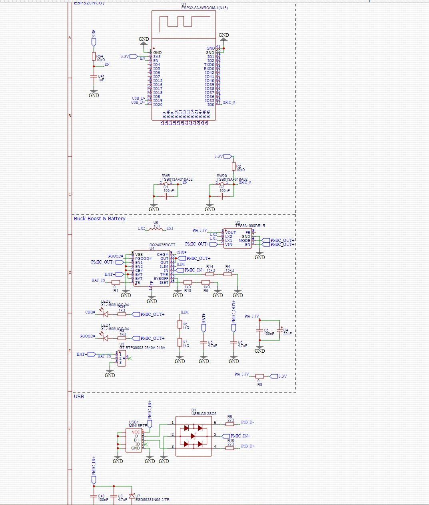
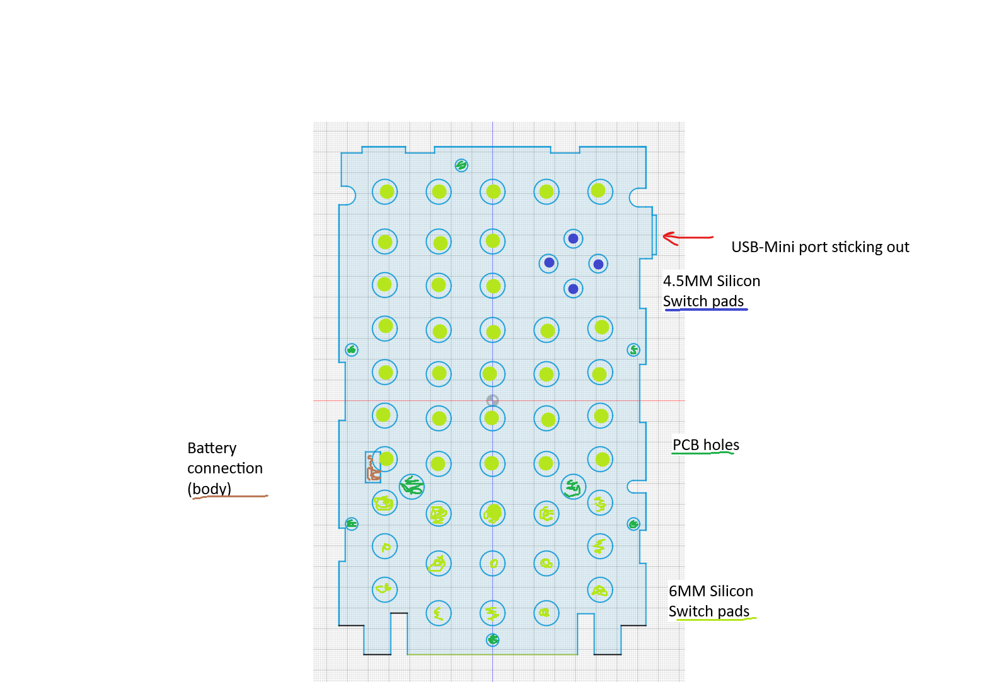

# November 27: Started component choosing and working on the schematic for the mainboard

I have made a start on the schematic for the mainboard while also looking for suitable components. Im going to buy the components exclusivly on LCSC since I am comforatble with its process and quality.

I've already made the battery management for the original li-ion of the TI-84 with a PMIC (power management integrated circuit) and for that i also required a buck-boost to get a stable 3.3V out of it. The buck-boost I've finished due to a very simple to use ic. The ESP32-S3 module also has seen some progress on connecting it to the power and a few reset buttons.

**Total time spent: 1.5 hours**

# November 27: Designed the mainboard border-outline and other important positions

By measuring and comparing to a disassembled TI-84+ CE-T for the layout of parts like the battery connector and usb-b mini port to make the mainboard compatible with the original shell of the TI-84 with no modification required.

Also a really important feature for this project is that the silicone switch mat compatible with my mainboard to give it the same feel and compatibility between the original mainboard and the custom one.

**Total time spent: 3 hours**
