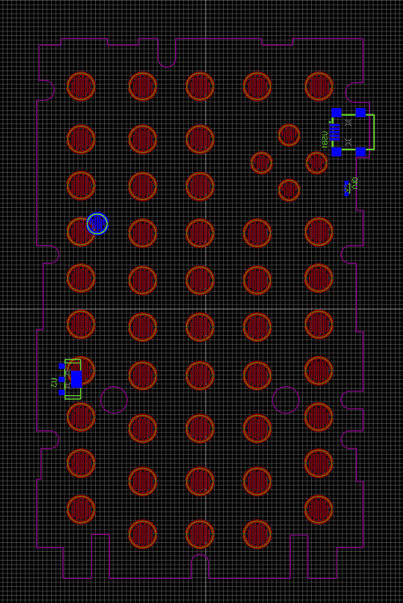
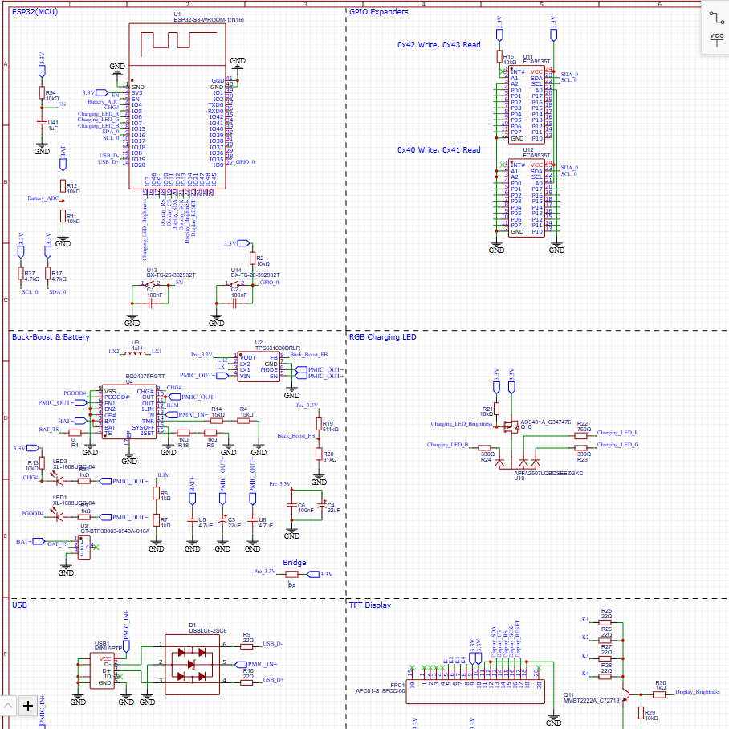
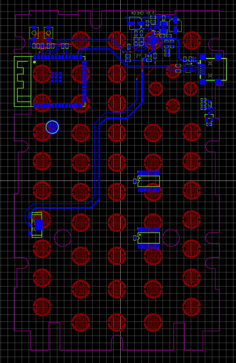

# October 27: Designed the mainboard border-outline and other important positions

By measuring and comparing to a disassembled TI-84+ CE-T for the layout of parts like the battery connector and usb-b mini port to make the mainboard compatible with the original shell of the TI-84 with no modification required.

Also a really important feature for this project is that the silicone switch mat compatible with my mainboard to give it the same feel and compatibility between the original mainboard and the custom one.

**Total time spent: 3 hours**

# October 27: Started component choosing and working on the schematic for the mainboard

I have made a start on the schematic for the mainboard while also looking for suitable components. Im going to buy the components exclusivly on LCSC since I am comforatble with its process and quality.

I've already made the battery management for the original li-ion of the TI-84 with a PMIC (power management integrated circuit) and for that i also required a buck-boost to get a stable 3.3V out of it. The buck-boost I've finished due to a very simple to use ic. The ESP32-S3 module also has seen some progress on connecting it to the power and a few reset buttons.

**Total time spent: 1.5 hours**

# October 28: Test fitting of PCB and modifying small defects and silicone switch pads design and placement on PCB

First I've printed out the mainboard mockup I designed yesterday. The first version had an offset on some of the button pads and the mounting holes of some were a bit offset too. Then I redesigned the few flaws and it fit perfectly now. Since I then knew the position of the silicone switch mat pads I could design the sort of fins as the button pads and place them around the PCB layout to later connect the pads themself. Also I have given each button pad their own net-name following what is said on the button of the TI84 Plus CE-T. 

**Total time spent: 2.5 hours**

Updated the schematic by adding GPIO expanders, finalizing the buck converter design, adding the screen connector and ESP32 connections, integrating a right-angle RGB LED, and adding charging detection to the ESP32.

# October 28: Worked on the schematic and added nearly all last features

I went and worked on nearly all the parts of the schematic that needed finishing. I've finished the: GPIO expanders (for the silicone mat switches) except the connection to the nets, the buck/boost converter to get a stable 3.3V from the battery, also the charging circuit is now done with charging detection to the ESP32 with a GPIO connection, integrating of the right-angle RGB LED for status of the mainboard visible from the outside and finally the screen connection over SPI with backlight control.

**Total time spent: 2.25 hours**

# October 28: Finished and reviewed the schematic and working on the PCB Layout

I finished the schematic with the pull-up resistors and other small things. I also peer reviewed the entire schematic for any mistakes and fixed a few small ones. Then I moved to the PCB layout where I place all the switch pads already yesterday so I could start for now with routing of the: ESP32, USB-B-Mini connector, PMIC, buck-boost converter, RGB-LED and the battery connection.

**Total time spent: 2.25 hours**
