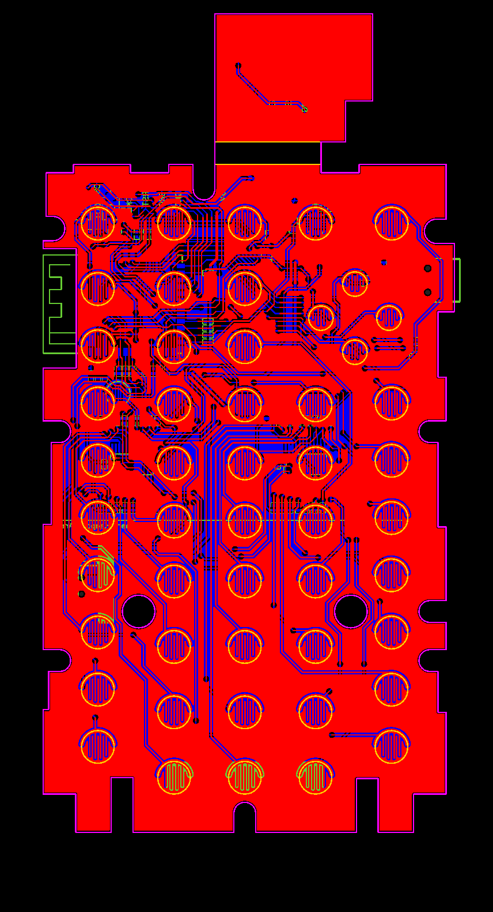
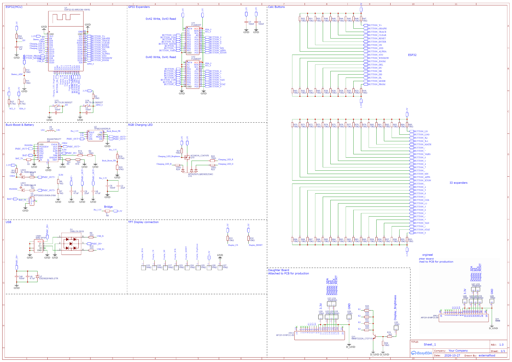
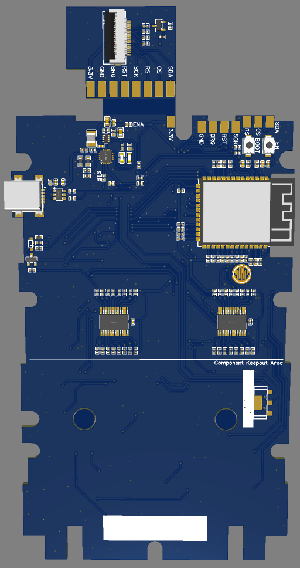
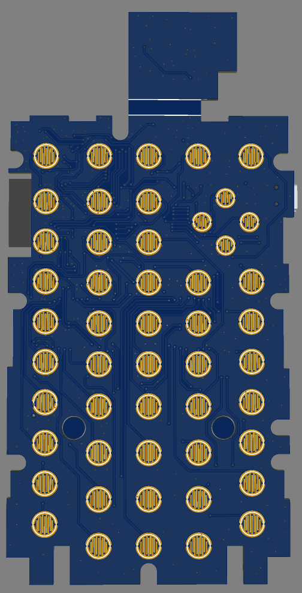

# OpenTI

**An open-source replacement motherboard for the TI-84 Plus CE-T powered by an ESP32-S3.**

OpenTI is a hardware project aiming to replace the original motherboard of the TI-84 Plus CE-T with a complete replica of the PCB. The goal is to make a custom, fully open replacement to experiment with any features that are available to the calculator, such as way more compute and maybe even raytracing ;)

Disclaimer: this is NOT a cheating device. I've disabled a few features that are hardware dependent, so trust me, it will take you way more time to get this working for cheating than just studying and getting a good grade :)

---

## Digital images of the PCB

### PCB Design/layout of the PCB

### Schematic of the PCB

### PCB Screenshots from EasyEDA

| Front of PCB | Back of PCB |
|---|---|
|  |  |

---

## Features of the mainboard

- **ESP32-S3:** an ESP32-S3 (with 16 MB flash) was chosen because it has the compute and I/O required for such an implementation. Also with the 16 MB flash, there is no issue with unoptimized code with assets, etc.
- **Original enclosure compatibility:** using the original TI-84 Plus CE-T mainboard as a template for this replacement board, there are no (or minimal) modifications required while reusing components like the battery and silicon touch panel.
- **Battery management:** As said earlier, it is compatible with the original li-ion battery with a voltage divider to measure battery levels.
- **3.3 V power rail:** A very tiny (and actually very good) buck-boost is used to get a stable 3.3V for the whole system from the battery.
- **Display connectivity:** A new screen (SPI-based 2.8" TFT LCD) needs to be unfortunately placed in the case due to the incompatible/unknown protocol of the original screen.
- **Status LED:** A LED visible from the outside from the original LED port shows charging states.
- **USB connectivity:** Using the same connector as the original, it can still charge with it, but also it has a custom interface to load new binaries, etc.

## Bill of Materials

The complete Bill of Materials is available as a CSV file:

**[OpenTI-84-BOM.csv](OpenTI-84-BOM.csv)**

The BOM is dropped in for LCSC.com but also can be manually purchased from every major electronics distributor (may need to buy special components like the screen or other stuff separate from other sites when not using LCSC.com)

---

## Design Files and Manufacturing

For manufacturing your own board, you can first test fit the mainboard and subboard with the STEP files:

| File | Description |
|---|---|
| [OpenTI-84-EasyEDA-PCB.json](pcb/OpenTI-84-EasyEDA-PCB.json) | EasyEDA PCB design |
| [OpenTI-84-EasyEDA-SCH.json](pcb/OpenTI-84-EasyEDA-SCH.json) | EasyEDA schematic |

For actually buying all the parts and stuff, you can use the GERBER and the BOM to order it.

**Make sure that the PCB is 1mm thick else the battery and USB connector won't line up, and make sure it is set to EING and not HASL or any other option for the longevity of your board!!**

| File | Description |
|---|---|
| [OpenTI-84-Gerber.zip](pcb/OpenTI-84-Gerber.zip) | PCB manufacturing GERBER files |
| [OpenTI-84-BOM.csv](OpenTI-84-BOM.csv) | Bill of Materials |

The PCB manufacturing files were prepared for production through JLCPCB but will probably work with other manufacturers.

---

## Development Journal

The development process and the logging of it are documented in [JOURNAL.md](JOURNAL.md), as per part of Hackclub Forge.

---

## License

This project is released under the **MIT License**. See [LICENSE](LICENSE) for details.

---

## Disclaimer

OpenTI is an independent, open-source hardware project and is not affiliated with, endorsed by or associated with Texas Instruments.

TI-84 Plus CE-T is a trademark of Texas Instruments. All trademarks belong to their respective owners.