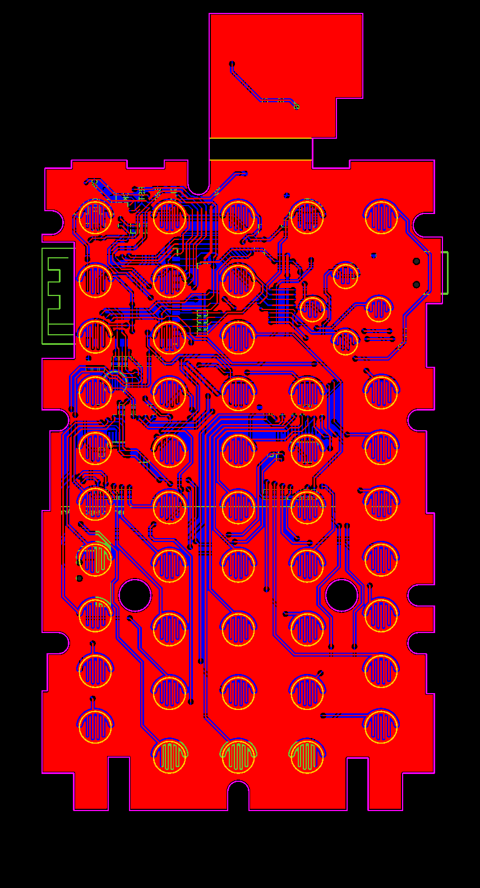
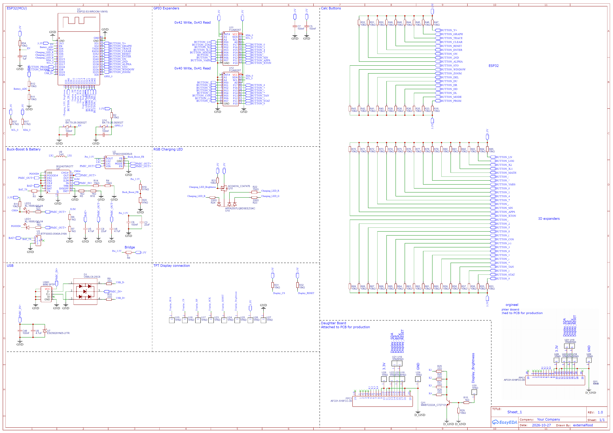
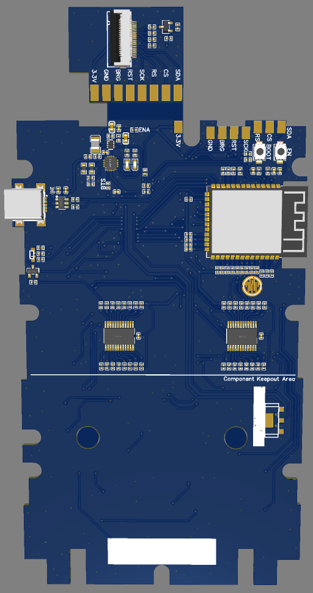
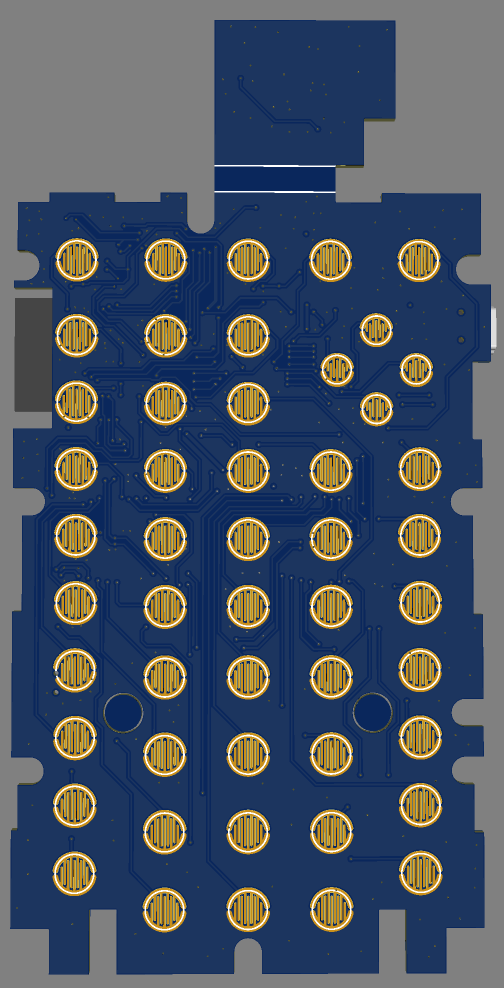

# OpenTI

**An open-source replacement motherboard for the TI-84 Plus CE-T, powered by the ESP32-S3.**

OpenTI is a hardware project aiming to replace the original motherboard of the Texas Instruments TI-84 Plus CE-T with a completely custom-designed, open-source PCB. The goal is to preserve compatibility with the original calculator enclosure, display, battery and silicone keypad while replacing the original electronics with a modern ESP32-S3-based design.

The project was created to explore whether the TI-84 Plus CE-T could be given a new, more accessible and customizable hardware platform without sacrificing the original calculator's form factor. By making the hardware designs, schematics and manufacturing files publicly available, OpenTI aims to make experimentation, modification and further development possible for everyone.

> **Project status:** PCB design completed and manufacturing files prepared. Hardware assembly and full functional validation are still to be documented.

---

## Repository Structure

```text
hardware/
|-- easyeda/          EasyEDA PCB and schematic source files
|-- manufacturing/    Gerber package and Bill of Materials
`-- mechanical/       Mechanical DXF drawing
firmware/             ESP32-S3 firmware foundation sketch
images/               Gallery renders and development journal photos
JOURNAL.md            Development journal
LICENSE               MIT license
```

---

## Gallery

### PCB Design



### Schematic



### PCB Renders

| Front | Back |
|---|---|
|  |  |

---

## Features and Design Goals

- **ESP32-S3:** Modern microcontroller platform serving as the main processing unit.
- **Original enclosure compatibility:** Designed around the dimensions and mounting positions of the original TI-84 Plus CE-T motherboard.
- **Original keypad compatibility:** Retains compatibility with the original silicone button membrane using custom-designed PCB contact pads.
- **Battery management:** Designed to work with the original lithium-ion battery using a dedicated power-management IC.
- **3.3 V power supply:** Buck-boost conversion provides a stable 3.3 V supply from the battery.
- **Display connectivity:** SPI interface for connecting the calculator display, including backlight control.
- **GPIO expansion:** GPIO expanders handle the multiple keypad inputs.
- **Charging detection:** Battery charging status can be detected by the ESP32.
- **RGB status LED:** Right-angle RGB LED provides externally visible status indication.
- **USB connectivity:** Designed around the original USB Mini-B connector position.

## Hardware Design

The motherboard is designed to fit inside the original TI-84 Plus CE-T housing without requiring modifications to the enclosure.

During development, the original calculator was disassembled and measured to determine the exact positions of important components, including the battery connector, USB connector, mounting holes and keypad contacts.

The PCB layout was developed with these mechanical constraints in mind. Physical 3D-printed board mockups were used to verify component positioning, mounting holes and overall fit before finalizing the PCB layout.

### Power Management

The power-management circuitry consists of a dedicated PMIC for battery management and a buck-boost converter to generate a stable 3.3 V supply for the electronics.

### Keypad

The original silicone keypad membrane is intended to remain usable. Custom PCB contact pads were positioned to match the original button locations, with GPIO expanders handling the keypad inputs.

### Display

The design includes an SPI display interface with backlight control. A separate display adapter/daughterboard is planned to accommodate the display's flexible cable and connection requirements.

### Main Controller

The ESP32-S3 module is the central component of the motherboard and provides the processing and GPIO functionality for the replacement hardware.

---

## Bill of Materials

The complete Bill of Materials is available as a CSV file:

**[OpenTI-84-BOM.csv](hardware/manufacturing/OpenTI-84-BOM.csv)**

The BOM contains the component information needed to source and assemble the PCB. Components were selected with LCSC availability in mind.

For the most accurate component references, quantities and purchasing information, consult the original CSV file.

---

## Design Files and Manufacturing

All hardware design files are available in this repository.

| File | Description |
|---|---|
| [OpenTI-84-EasyEDA-PCB.json](hardware/easyeda/OpenTI-84-EasyEDA-PCB.json) | EasyEDA PCB design |
| [OpenTI-84-EasyEDA-SCH.json](hardware/easyeda/OpenTI-84-EasyEDA-SCH.json) | EasyEDA schematic |
| [OpenTI-84-Gerber.zip](hardware/manufacturing/OpenTI-84-Gerber.zip) | PCB manufacturing Gerber files |
| [OpenTI-84-DXF-REV2.dxf](hardware/mechanical/OpenTI-84-DXF-REV2.dxf) | Mechanical DXF drawing |
| [OpenTI-84-BOM.csv](hardware/manufacturing/OpenTI-84-BOM.csv) | Bill of Materials |

The PCB manufacturing files were prepared for production through JLCPCB.

---

## Development Journal

The development process, design decisions and progress updates are documented in the [JOURNAL.md](JOURNAL.md) file.

The journal includes:
- Mechanical measurements and enclosure compatibility work.
- Component selection and schematic development.
- Power-management circuit design.
- Keypad contact positioning and GPIO expansion.
- PCB routing and component placement.
- 3D-printed mechanical fit testing.
- Final PCB checks and manufacturing preparation.

---

## License

This project is released under the **MIT License**. See [LICENSE](LICENSE) for details.

---

## Disclaimer

OpenTI is an independent, open-source hardware project and is not affiliated with, endorsed by or associated with Texas Instruments.

TI-84 Plus CE-T is a trademark of Texas Instruments. All trademarks belong to their respective owners.
